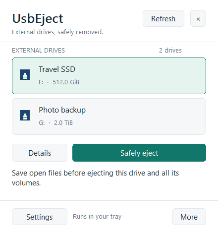
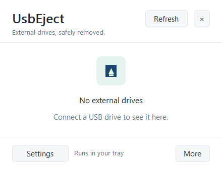
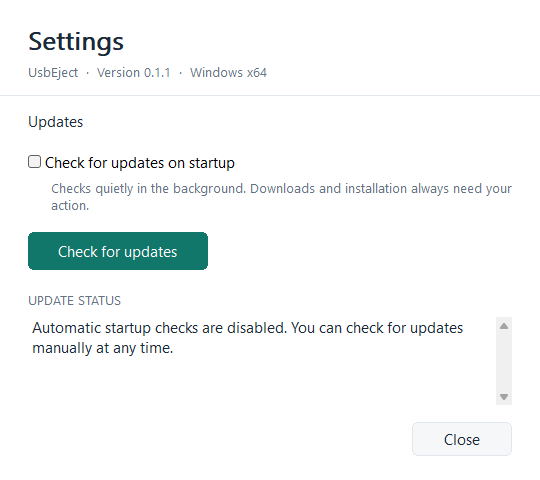
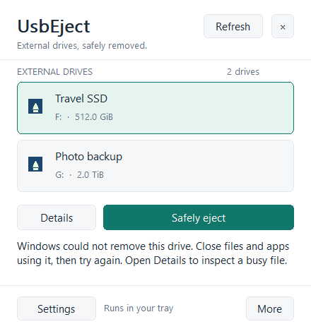

# UsbEject

A small native Windows tray utility for reviewing and safely ejecting an external physical drive and all its volumes. Independent MIT-licensed implementation with original UI and artwork; no affiliation with USB Safely Remove.

**Status: v0.1.1 local preview.** The main interaction is a compact tray panel, with separate Settings and Drive details windows. This revision fixes gray native-control backgrounds during live painting, simplifies the empty state and replaces the panel's duplicate native caption with a compact application header. The actual native interface has been captured and reviewed without Computer Use. Real device ejection, physical tray clicks and update installation still need manual validation. No repository or release has been published by this development session.

## Capabilities

- A compact native tray panel with selectable drive cards, a short menu and a discoverable **More → Quit UsbEject** action. Settings and less frequent drive diagnostics open separately. Manual launch opens the panel; `--background` starts quietly in the tray. No WebView or application GPU renderer.
- A physical-device list with Windows names, local display aliases, bus, serial, drive letters, mounted folders and volume labels. Each volume shows capacity/free space when Windows supplies it. Physical capacity may be `Unknown` without sufficient query access.
- USB, FireWire, SD and MMC storage candidates. Internal SATA/NVMe, virtual/network disks and the disk containing Windows are excluded. Ejection is disabled if the Windows disk cannot be identified, hot-plug metadata is unavailable, a volume spans disks, or multiple discovered disks share the same direct device parent.
- Explicitly select a drive, then choose **Safely eject**. A scan never automatically selects a new drive. Discovery and identity validation repeat before the supported Windows PnP removal request. Display labels never rename a filesystem volume.
- Windows veto type, veto source and status code on refusal. Candidates whose executables run from that drive are listed as partial diagnostic information. **Inspect file** uses Restart Manager to discover applications using one chosen file, without shutting them down.
- Nonblocking startup update checks, a persistent opt-out, manual **Check for updates**, and user-initiated **Download and install** with progress, SHA-256 verification, a staged portable replacement and restart.

## Build and package

Target: Windows 10 1809+ / Windows 11, **x64**. These are intended runtime targets, not a completed compatibility certification. Build prerequisites: stable Rust with the MSVC toolchain, Visual Studio C++ Build Tools and a Windows SDK including `rc.exe`. No extra runtime, driver, service, administrator prompt or installation is intended. CRT linkage is static for the supported target.

From this repository in PowerShell:

```powershell
./scripts/verify.ps1 -Offline
./scripts/package.ps1 -Offline
```

Omit `-Offline` when dependencies need to be fetched. Both scripts use a repository-local `target` and at most two Cargo jobs. Verification runs formatting, Clippy with warnings denied and fixture tests; it never launches the GUI or ejects devices. Packaging compiles resources and a release binary without starting it.

Output in `dist/`:

- `UsbEject-v0.1.1.exe` — the single Windows x64 executable.
- `SHA256SUMS`, `LICENSE`, `THIRD-PARTY-NOTICES.txt`, `build-info.json`, `inspection.json`.

The filename intentionally has no architecture suffix while only one executable architecture is distributed. Keep license notices with redistributed copies. The CI workflow builds review artifacts only; it does not publish GitHub Releases.

## Everyday use

1. Start the portable executable from a writable folder. No startup registration or system configuration is performed.
2. Single-click the tray icon to open the panel. Select the physical drive; **Details** shows all its volumes. Save your files, then choose **Safely eject** to request removal of the selected disk and all its volumes.
3. Wait for Windows to accept removal before unplugging. A refusal means you should resolve the reported cause and retry. Cancellation can stop preparation; an active Windows ejection call cannot be interrupted or undone.
4. If a file seems busy, open **Details**, enter its existing full path under **Inspect a busy file**, then choose **Inspect file**. Only files on that device's mounted paths are accepted. An empty result does not prove the device is unused.
5. In **Details**, set a local **Display label** and choose **Save label**. An empty value restores the Windows name. Devices without unique serials can share a Windows identity, or change identity between ports; aliases are cosmetic.
6. Clicking away, pressing Escape or closing the panel keeps UsbEject in the tray. Open **Settings** deliberately for update preferences. Use **More → Quit UsbEject**, the tray menu's Quit action, or **Ctrl+Q** to exit. If creating the tray icon fails, closing the panel exits instead.

When switching from an older portable preview, quit that running instance before opening the new EXE. The single-instance behavior otherwise restores the already-running version.

Settings live in `%LOCALAPPDATA%\UsbEject\settings.json`. They are saved by replacement after flushing a staged file. Invalid or newer-schema settings are preserved and editing is disabled for that session. No telemetry, volume contents, device identities or diagnostic process lists are sent online. Only update checks/downloads use the network.

## Updates

The separate **Settings** window shows the installed version and startup-check toggle. Disabling the toggle makes no update request at the next startup; manual checking remains available. Startup failures and no-update results stay there. The drive panel stays focused on removal. An available update also produces a quiet tray notification.

The planned canonical source is [siarheisinelnikau/usb-eject](https://github.com/siarheisinelnikau/usb-eject). Until the repository and a compatible release exist, checks report the source as unavailable. A 404, rate limit or network failure is never presented as “up to date.” Stable releases must include `UsbEject-vVERSION.exe` and a `SHA256SUMS` entry for that exact filename. See [release preparation](docs/RELEASING.md).

**Download and install** is explicit consent to download, verify, close UsbEject, replace its EXE and restart it. It never runs unattended from a startup check. Cancellation ends once verified installation handoff begins. The helper waits for the old process to exit, retains an executable backup beside the installation and leaves settings in their own data directory. It attempts rollback if creating the restarted process fails; it does not detect later crashes in an already-started new version. Installation into a protected folder fails without requesting elevation. Staging files and backup EXEs can be removed manually once the updated version is confirmed to work. Checksums authenticate integrity against the canonical HTTPS release; releases are not code-signed yet.

## Limits and verification

- Driver behavior controls whether a particular bridge/card reader accepts disk-node removal. UsbEject never escalates to ejecting a USB hub or parent controller. eSATA, storage pools, spanned/dynamic volumes and shared enclosures are outside the supported first slice.
- No force-unmount, process termination, handle closing, power-off, return-device feature or service installation is implemented.
- Restart Manager is a specific-file diagnostic, not an exhaustive volume-wide handle scanner. Protected processes, directory handles, drivers and other files may remain undiscovered.
- Device notification generations and repeated identity checks narrow unplug/replug races. Windows provides the final PnP decision; hardware race behavior must still be tested.
- Device/network calls can wait on Windows or a driver. They run off the UI thread; cancellation is cooperative. A removal request already inside Windows has no forced timeout.
- A release build and passing unit tests do not establish safe behavior on real hardware or the quality of the rendered interface. See [validation record](docs/VALIDATION.md), [architecture](docs/ARCHITECTURE.md) and [manual checks](docs/MANUAL_TESTS.md).

## Screenshots

These are real PNGs saved by the executable through its native Win32/GDI client-rendering path. The captures are isolated and do not enumerate or operate real drives, read user settings, contact update servers or automate the desktop. Populated names and capacities below are explicitly synthetic fixtures. Native title bars and the Windows notification area are outside these client-area screenshots.



Compact panel, selected sample drive, 100% scale. Selection is explicit in ordinary use; the fixture selects its first sample to show the action state.



Simplified empty state, 100% scale. Native background colors are also checked during reentrant Windows callbacks; a fresh PrintWindow screenshot alone would miss that regression.



Separate Settings window with startup checks disabled in the fixture, 100% scale.



Synthetic Windows-refusal state, 100% scale. No removal request was made to obtain this image.

## Bounded visual and rendering checks

```powershell
./scripts/capture.ps1 -OutputRoot E:/work/github/usb-eject/.test-output/visual-review -Measure
```

Build the release target first. This explicitly launches disposable diagnostic instances, writes native client PNGs for empty/populated/error/settings/details states plus 150% scale, and exits. It never activates a normal running instance or performs device/network/settings operations. Fresh output paths are required. `--capture OUTPUT.png --screen SCREEN --scale 100|150|200` is the executable's developer-only render/save/exit mode; `--measure OUTPUT.json [--screen settings]` records bounded visible, hidden and restored idle intervals. The review script also checks native color callbacks while application state is borrowed and rejects unexpected scene work in settled samples. Local native-checkbox backdrop requests are measured separately; they do not rebuild the Settings scene. These are not ordinary settings or a substitute for physical tray, keyboard or hardware checks. Additional reviewed captures: [drive details](docs/screenshots/drive-details.png) and [panel at 150%](docs/screenshots/panel-150.png).

## License

[MIT](LICENSE). Dependency notices are generated during packaging from the locked crate sources.
